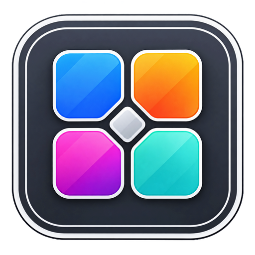
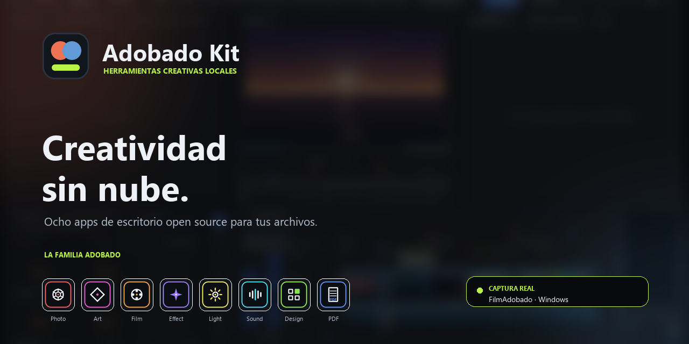
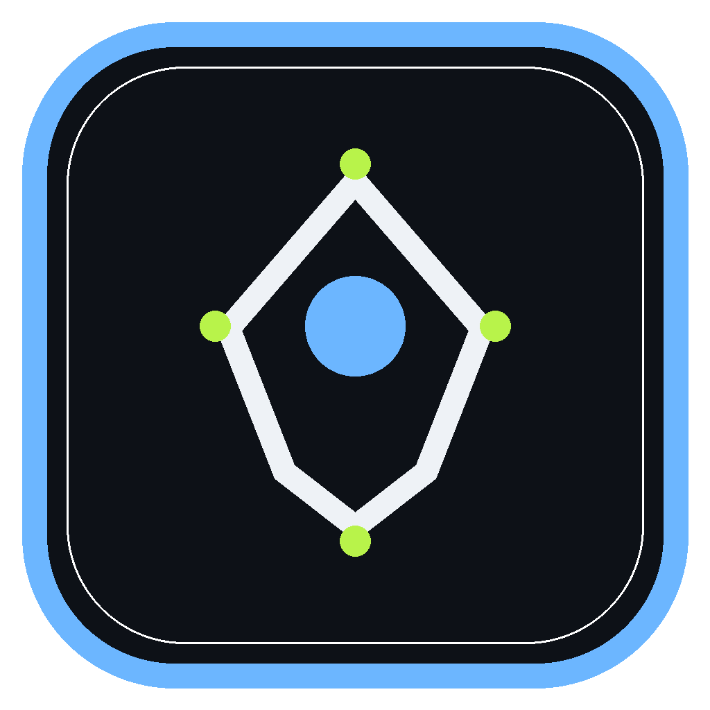
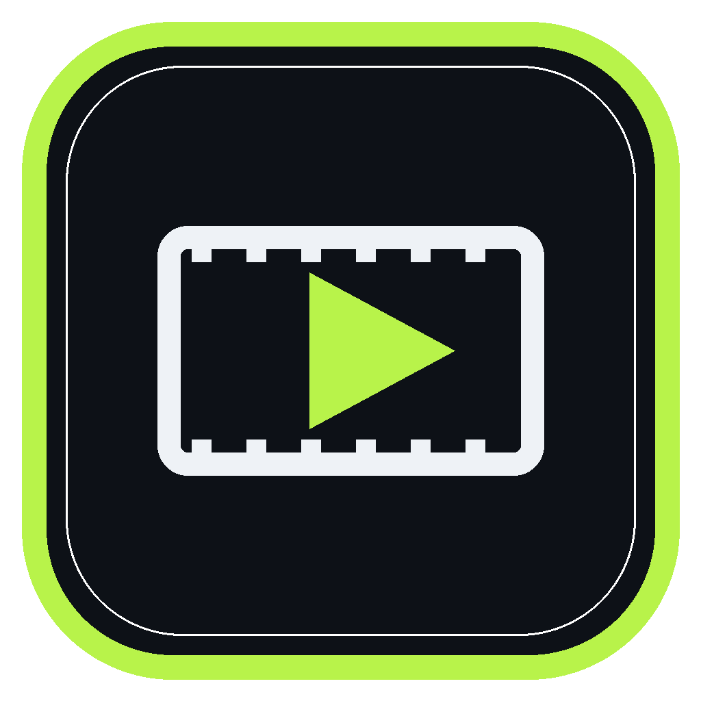
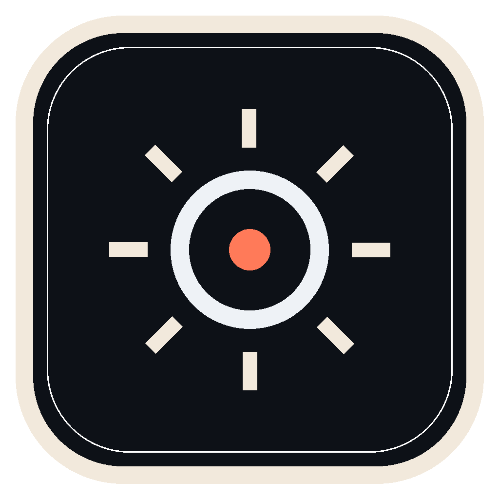
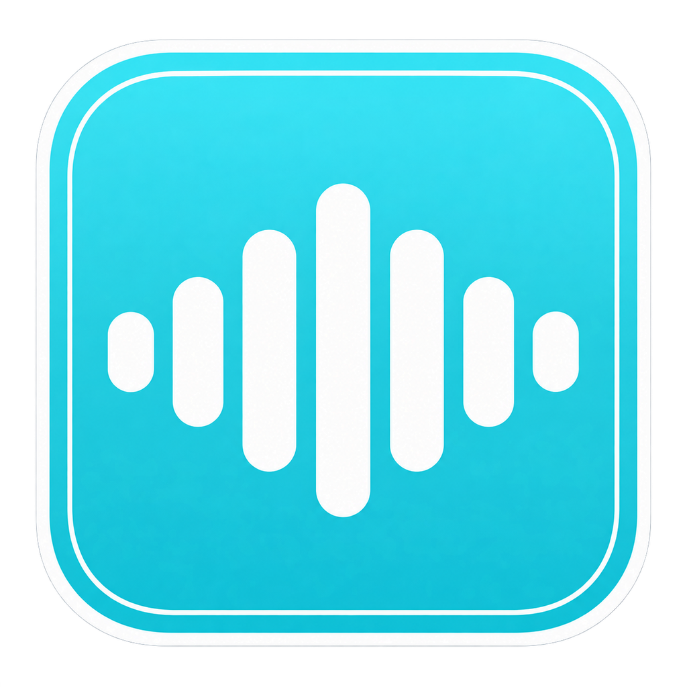
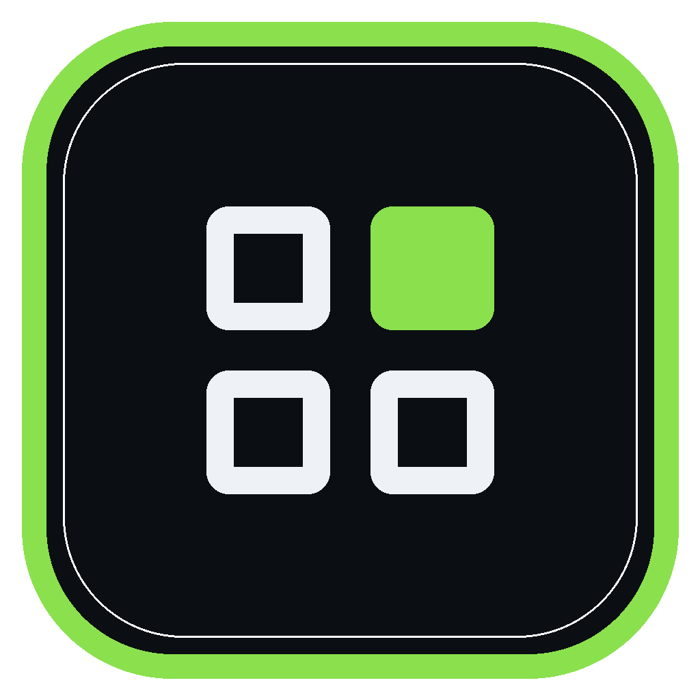
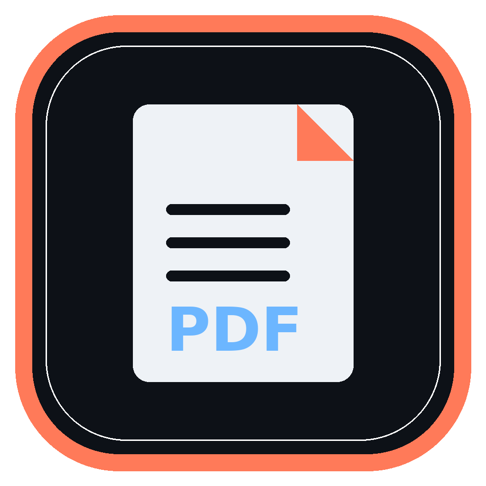

# Adobado Kit

**Foto, vídeo, ilustración, efectos, color, audio, diseño y PDF: elige una app según tu tarea.**

Ocho aplicaciones de escritorio para tareas distintas. Elige por lo que necesitas hacer y consulta qué se ha compilado, instalado y probado antes de descargar.

> **Adobado Kit no está afiliado a Adobe.** Es un proyecto personal e independiente. Los nombres de productos se usan solo para describir categorías de herramientas.

Imagen de presentación basada en una captura real de FilmAdobado; el desenfoque y la capa de marca son gráficos de presentación.

## Descargas

- **Launcher + instalador:** [AdobadoKit-Launcher-v0.3.2.zip](https://github.com/smouj/Adobado_Kit/releases/download/v0.3.2/AdobadoKit-Launcher-v0.3.2.zip). Abre o instala las apps, crea accesos directos y no requiere administrador.
- **Wallpapers:** [AdobadoKit-Wallpapers-v1.0.zip](https://github.com/smouj/Adobado_Kit/releases/download/v0.3.2/AdobadoKit-Wallpapers-v1.0.zip). 33 wallpapers para pantallas 16:9, 21:9, 16:10, 4:3 y móvil.

## Apps

| App | Para qué sirve | Estado de las pruebas |
|---|---|---|
|  [PhotoAdobado](https://github.com/smouj/PhotoAdobado) | Edita imágenes con capas, máscaras, PSD y ajustes. | Inicio comprobado en Windows · falta validar un archivo |
|  [ArtAdobado](https://github.com/smouj/ArtAdobado) | Crea ilustraciones vectoriales y trabaja con archivos SVG. | Compilación correcta · falta instalar y abrir |
|  [FilmAdobado](https://github.com/smouj/FilmAdobado) | Edita tus proyectos de vídeo. | Inicio comprobado en Windows · falta validar un archivo |
|  [EffectAdobado](https://github.com/smouj/EffectAdobado) | Aplica efectos visuales a tus proyectos. | Compilación correcta · falta instalar y abrir |
|  [LightAdobado](https://github.com/smouj/LightAdobado) | Revela fotografías y ajusta el color. | Compilación correcta · falta instalar y abrir |
|  [SoundAdobado](https://github.com/smouj/SoundAdobado) | Edita tus pistas de audio. | Inicio comprobado en Windows · falta validar un archivo |
|  [DesignAdobado](https://github.com/smouj/DesignAdobado) | Diseña y compón piezas gráficas. | Compilación correcta · falta instalar y abrir |
|  [PdfAdobado](https://github.com/smouj/PdfAdobado) | Lee, edita y organiza documentos PDF. | Compilación correcta · falta instalar y abrir |

El catálogo con commits, licencias y estado real está en [docs/APPS.md](docs/APPS.md).

## Estado

Los ocho proyectos compilan para Windows (20 de octubre de 2026). Una compilación correcta no confirma que la app se instale, se inicie o funcione con tus archivos.

- **PhotoAdobado, FilmAdobado y SoundAdobado:** instaladas y abiertas en Windows; falta completar una prueba con un archivo real.
- **ArtAdobado, LightAdobado, EffectAdobado, DesignAdobado y PdfAdobado:** compilación correcta; todavía falta instalarlas y abrirlas manualmente.
- Las descargas alpha de Photo, Film y Sound conservan el icono anterior y no han completado una prueba con un archivo real. Art, Light, Effect, Design y Pdf aún no tienen un paquete público.

Consulta el historial de compilación y el estado de cada app en [docs/APPS.md](docs/APPS.md).

## Antes de usar

1. **Archivos en tu equipo.** Las apps son de escritorio y procesan los archivos localmente; no necesitas una cuenta.
2. **Formatos y licencias.** Consulta en el repositorio de cada app los formatos admitidos, su licencia y los avisos de terceros.
3. **Estado de uso.** Separamos compilación, inicio en Windows y prueba completa con un archivo para que sepas qué está verificado.

## Uso

- Abre el hub en [index.html](index.html) o en https://smouj.github.io/Adobado_Kit/.
- El [launcher v0.3.2](https://github.com/smouj/Adobado_Kit/releases/tag/v0.3.2) incluye un instalador opcional que no requiere permisos de administrador.
- El pack de wallpapers contiene 33 fondos adaptados a varios dispositivos.
- El hub es HTML estático; las apps se mantienen y se compilan en sus repositorios independientes.

## Estructura

    Adobado_Kit/
    ├─ index.html                 # hub / landing
    ├─ assets/                    # logo, iconos y capturas
    ├─ docs/
    │  ├─ APPS.md                 # catálogo y estado real
    │  ├─ ROADMAP.md
    │  ├─ BRAND.md
    │  └─ UPSTREAM.md             # auditoría de ArtCraft
    ├─ tools/
    │  ├─ check_brand_assets.py   # paridad de iconos
    │  ├─ generate_brand_previews.py
    │  ├─ generate_social_preview.py
    │  ├─ import_apps.py
    │  └─ sync-upstream.sh
    ├─ LICENSE
    └─ THIRD_PARTY_NOTICES.md

## Desarrollo

El hub es HTML, CSS y JavaScript sin frameworks. Las apps son proyectos Rust independientes; sus repos contienen sus propias instrucciones de build.

## Licencia

MIT para el código del hub. Cada app conserva las licencias de su upstream. Consulta [THIRD_PARTY_NOTICES.md](THIRD_PARTY_NOTICES.md).

Hecho por [SMOUJ013](https://github.com/smouj).
