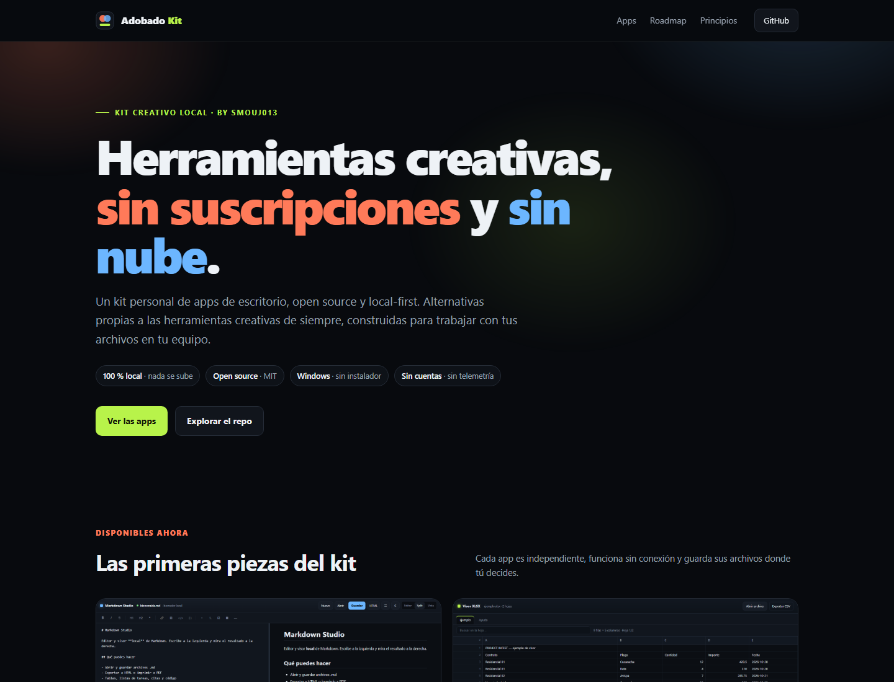

# Adobado Kit

**Herramientas creativas locales, sin suscripciones y sin nube.**

[](LICENSE)
[](https://github.com/smouj/Adobado_Kit/releases)
[](#principios)
[](LICENSE)
[](#apps)

Un kit personal de aplicaciones de escritorio para trabajar con tus archivos en tu equipo. Cada app es independiente, funciona sin conexión y no pide cuentas.



> **Adobado Kit no está afiliado a Adobe.** Es un proyecto personal e independiente. Los nombres de productos se usan solo para describir categorías de herramientas.

## Apps disponibles

| App | Qué hace | Estado |
|---|---|---|
| [Markdown Studio](apps/markdown-studio/) | Editor y visor Markdown con GFM, resaltado, índice y exportación HTML. | v1.0.0 |
| [XLSX Viewer](apps/xlsx-viewer/) | Visor local de Excel (.xlsx/.xlsm/.xls/.csv) con búsqueda e inspector de celda. | v1.0.0 |

Abre el hub en [`index.html`](index.html) o entra directamente en cada app.

## En el taller

- **Adobado Photo** — ajustes, recorte y exportación de imagen.
- **Adobado Vector** — editor SVG con nodos y formas.
- **Adobado Film** — timeline, corte y subtítulos.
- **Adobado Sound** — forma de onda, corte y normalización.
- **Adobado Press** — composición y PDF.
- **Adobado Light** — revelado y color para fotografía.

El detalle y el orden están en [docs/ROADMAP.md](docs/ROADMAP.md). No hay fechas infladas: cada herramienta se publica cuando es útil.

## Upstream: ArtCraft

Las futuras apps de categoría Adobe se construirán como derivados de [ArtCraft](https://github.com/storytold) (MIT/Apache-2.0), con commits fijados, avisos conservados y rebranding propio. La marca, el wordmark y los logos de ArtCraft son trademarks y no se usan en este kit.

Estado actual: auditoría y pipeline de sincronización listos; **ninguna app derivada se presenta como disponible**. El detalle legal y técnico está en [docs/UPSTREAM.md](docs/UPSTREAM.md).

## Principios

1. **Local primero.** Tus archivos no salen del equipo. Sin cuentas, servidores ni telemetría.
2. **Abierto de verdad.** Código MIT, dependencias auditables y formatos estándar.
3. **Herramientas honestas.** Cada app hace una cosa bien y dice claramente qué no hace.

## Estructura

```
Adobado_Kit/
├─ index.html                 # hub / landing
├─ apps/
│  ├─ markdown-studio/        # editor y visor Markdown
│  └─ xlsx-viewer/            # visor de Excel
├─ assets/                    # logo y capturas
├─ docs/
│  ├─ ROADMAP.md
│  └─ BRAND.md
├─ LICENSE
└─ THIRD_PARTY_NOTICES.md
```

## Uso

- **Hub:** abre `index.html` en el navegador.
- **Apps:** cada carpeta incluye su `index.html` y, cuando aplica, un `launcher.vbs` para abrirla como ventana de app en Windows.
- **Sin instalador:** no hay build, ni Node, ni dependencias que instalar.

## Desarrollo

Las apps son HTML, CSS y JavaScript sin frameworks. Las librerías de terceros están vendorizadas en cada app y sus licencias se conservan en `vendor/LICENSES/` o en los avisos correspondientes.

Para publicar el hub y las apps en GitHub Pages, sirve la raíz del repo. No hay backend.

## Licencia

MIT para el código del kit. Cada app conserva sus avisos de terceros. Consulta [THIRD_PARTY_NOTICES.md](THIRD_PARTY_NOTICES.md).

Hecho por [SMOUJ013](https://github.com/smouj).
